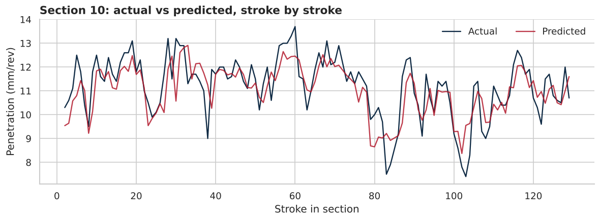
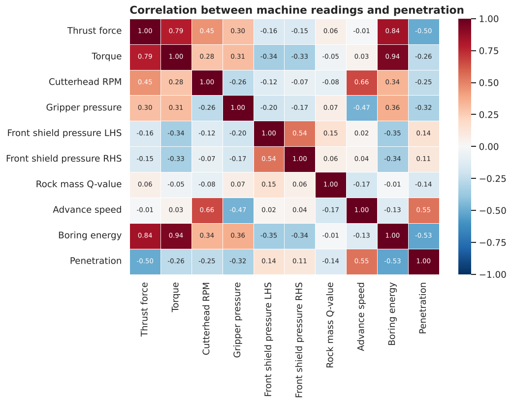
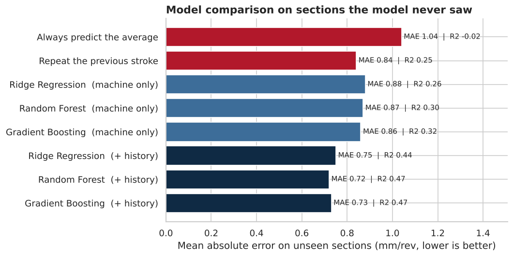

# TBM Penetration Prediction

Analysis of a tunnel boring machine (TBM) stroke log and a model that predicts the penetration of the next stroke from machine readings, rock quality and recent strokes. It also flags strokes likely to be slow before they are bored.

**Live demo:** https://mq-tbm-penetration-prediction.streamlit.app/



## Problem

A TBM advances one stroke at a time. Penetration, the depth cut per revolution of the cutterhead (mm/rev), sets how fast the tunnel moves forward. Knowing what the next stroke will deliver helps plan progress and spot slow ground early. This project answers:

1. What does the stroke log show about penetration and the machine readings around it?
2. How well can the next stroke's penetration be predicted from information available before it is bored?
3. Can slow strokes be flagged ahead of time?

## Dataset

`data/tbm_strokes.xlsx`: 1,472 strokes from one TBM drive in 2016.

| Column | Unit |
|---|---|
| Advance time | min |
| Excavation per stroke | m |
| Boring energy | N/mm2 |
| RPM | rev/min |
| Torque | kN-m |
| Thrust force | kN |
| Speed | mm/min |
| Gripper pressure | bar |
| Total revolution | count |
| Front shield pressure LHS and RHS | bar |
| Q-value (NJC) | rock mass quality, 3 or 4 |
| Q-value based on boring energy | class 2 to 5 |
| Penetration (target) | mm/rev |

## Data quality

- The sheet has a blank row, a row of names and a row of units above the data. Read with default settings, every column becomes text.
- The serial number restarts 10 times, splitting the log into 11 sections. Stroke numbers repeat across sections with different readings, so they are not duplicates.
- One date is stored as text and several sections have day and month swapped, so dates are not used.
- 16 strokes with impossible readings are removed: gripper pressure up to 1,190 bar, excavation per stroke of -0.12 m or 14.2 m, an advance time of 0, front shield pressure of 0 or 178 bar, and one penetration of 44.5 mm/rev (three times the next highest stroke).
- No missing values. 1,456 strokes remain.

## Key findings

- **Penetration is defined as advance speed divided by RPM.** This holds in 1,469 of 1,472 rows. Boring energy equals torque x RPM / speed. Both columns therefore contain the answer.
- **Higher thrust goes with lower penetration** (r = -0.50). Operators push harder in harder rock, so thrust partly measures how hard the ground is.
- **Better-quality rock is slower to cut.** Median penetration is 12.0 mm/rev at Q = 4 against 12.5 at Q = 3.
- Median penetration is 12.2 mm/rev, and the slowest quarter of strokes are below 11.3 mm/rev.



## Model

### Inputs

Known before the next stroke: thrust, torque, RPM, gripper pressure, front shield pressures, rock Q-value, the previous stroke's penetration and the average of the last five strokes in the same section.

Not used: advance speed and boring energy (they contain the penetration), advance time, excavation and total revolutions (only known after the stroke), stroke number and date.

### Validation

Consecutive strokes are very similar, so a random train/test split lets the model copy answers from neighbouring strokes. Every score here comes from **leaving whole sections out**: each section is predicted by a model trained only on the other sections (GroupKFold, 5 folds).

### Results

| Model | Inputs | MAE (mm/rev) | R2 |
|---|---|---|---|
| Always predict the average | none | 1.04 | -0.02 |
| Repeat the previous stroke | previous stroke | 0.84 | 0.25 |
| Gradient Boosting | machine readings and rock quality | 0.86 | 0.32 |
| Ridge Regression | machine readings, rock quality and history | 0.75 | 0.44 |
| **Random Forest** | **machine readings, rock quality and history** | **0.72** | **0.47** |

- 75% of strokes are predicted within 1 mm/rev.
- A random split would report R2 0.51. The section split (0.47) is the honest number, because each new stretch of tunnel is new ground.
- The model relies most on the previous stroke's penetration, then thrust, RPM and torque.

### Flagging slow strokes

A stroke is slow if its penetration is in the slowest quarter (below 11.3 mm/rev).

| Model | ROC AUC | Balanced accuracy | Slow strokes caught | False alarms |
|---|---|---|---|---|
| Logistic Regression | 0.815 | 0.758 | 74% | 22% |
| Random Forest | 0.833 | 0.756 | 67% | 16% |

### What changed from the first version

- The first version read the units row as data, so every column was text and one step deleted all columns (shape `(1474, 0)`), followed by a `KeyError` on `Penetration`.
- Its "weak supervision" labels used a fixed pressure threshold that put all 1,473 strokes in one class. The reported 100% accuracy and perfect confusion matrix meant the model only ever saw one answer. This version uses the recorded penetration.
- Adding advance speed or boring energy as inputs would lift R2 to 0.89 or 0.68. The notebook shows this and explains why they are excluded.



## Web app

- **Predict next stroke:** set thrust, torque, RPM, pressures, rock Q-value and recent penetration to get the predicted penetration, the expected advance speed and the chance of a slow stroke
- **Explore the log:** distributions, correlations, thrust/torque/RPM against penetration, rock quality and sections
- **Model:** results, validation approach and the leakage check
- **Data quality:** checks, removed strokes and a download of the cleaned data

## Tech stack

Python, Pandas, NumPy, Matplotlib, Seaborn, scikit-learn, Streamlit, Jupyter Notebook

## Project structure

```
tbm-penetration-prediction/
├── app.py                                  Streamlit app
├── data/
│   └── tbm_strokes.xlsx                    Stroke log
├── notebooks/
│   └── tbm_penetration_prediction.ipynb    Cleaning, analysis, modeling and findings
├── reports/
│   ├── figures/                            Charts exported by the notebook
│   ├── model_comparison.csv
│   ├── feature_importance.csv
│   └── out_of_section_predictions.csv
├── src/
│   ├── data.py                             Reading and cleaning the sheet
│   ├── analysis.py                         Exploratory charts
│   └── model.py                            Features, validation, models and leakage check
├── requirements.txt
└── README.md
```

## Run locally

```bash
git clone https://github.com/Qasim00760/tbm-penetration-prediction.git
cd tbm-penetration-prediction
pip install -r requirements.txt
streamlit run app.py
```

To run the notebook:

```bash
pip install notebook
jupyter notebook notebooks/tbm_penetration_prediction.ipynb
```

## Author

Muhammad Qasim
[Portfolio](https://qasim.devsil.com) | [LinkedIn](https://www.linkedin.com/in/muhammad-qasim-1944b8349) | [GitHub](https://github.com/Qasim00760)
